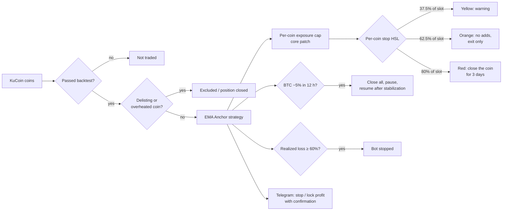

# TB Turbo 6.0 — a KuCoin Futures bot that adapts to the strategy, not the other way round

**English** · [Русский](README.ru.md)

[](#support-the-project)

> **In short.** TB is a complete trading system for KuCoin Futures: a Python +
> Rust core, a web panel, a Telegram bot, server deployment and a simulator.
> The strategy is not hard-coded: it is defined by a *preset* — a base config
> plus a list of overrides. The default today is **Turbo 6.0**, an aggressive
> EMA Anchor scalping profile (4 coins × exposure 20, leverage 20). In a minute
> you can turn it into a cautious leverage-10 profile or a "regular" long-term
> bot without writing a single line of code.
>
> ⚠️ Turbo 6.0 is a **high-risk** profile. Read [Risks](#risks--read-before-you-start)
> before you give the bot any money.

Most comments and internal docs in the code are in Russian.

---

## Contents

- [What the bot does](#what-the-bot-does)
- [How the EMA Anchor strategy works](#how-the-ema-anchor-strategy-works)
- [Turbo 6.0: parameters and results](#turbo-60-parameters-and-results)
- [The key advantage: one system, any strategy](#the-key-advantage-one-system-any-strategy)
- [How we tune settings](#how-we-tune-settings)
- [Layers of protection](#layers-of-protection)
- [Risks — read before you start](#risks--read-before-you-start)
- [Configuration options](#configuration-options)
- [Quick start](#quick-start)
- [Repository layout](#repository-layout)
- [Support the project](#support-the-project)

---

## What the bot does

- **Trades KuCoin Futures** (USDT-M, long-only in the current profiles) on a
  curated coin list — up to 84 liquid contracts; Turbo 6.0 trades the 53 coins
  that passed backtesting.
- **Web panel**: preset, balance, exposure, number of positions, leverage,
  stops and filters — all as sliders and fields with hints.
- **"Bet" mode** (Turbo): the bot trades a dedicated balance, the panel watches
  the bet, locks in profit with one button, pauses on a BTC crash and resumes.
- **Telegram bot**: reports, stop and profit lock with a 60-second confirmation.
- **24/7 server**: one-command deployment (Ubuntu + systemd); the bot survives
  panel and server restarts; hourly snapshots and a morning report.
- **Paper trading and a simulator**: the same panel on historical data, with
  13 drill scenarios (bets, BTC crashes, delistings, restarts).

## How the EMA Anchor strategy works

EMA Anchor is a mean-reversion strategy with averaging down:

1. The bot builds a band from two moving averages of price (EMA 160 and 240
   minutes in Turbo 6.0).
2. It **buys below the band** at a distance `offset`, which widens when the
   market is volatile or the position is already large.
3. If the price keeps falling, it **buys more, lower**
   (`entry_double_down_factor`), lowering the average entry price.
4. It **sells above the band** once the price returns to the mean.

This way the bot earns on ordinary swings: most of the time it sits in cash
(time-weighted exposure ≈ 0.2–0.3 of the balance) and a position lives about
10 hours on average. The daily correlation with BTC is only ≈ 0.2: the bot
makes money in falling and rising markets alike, as long as they oscillate.

The weak spot of such a strategy is a **crash without a bounce**: averaging
down turns it into a large loss. That is why half of this project is not the
strategy but the [protection](#layers-of-protection) around it.

## Turbo 6.0: parameters and results

| Parameter | Value | Meaning |
|---|---|---|
| Strategy | EMA Anchor, long-only | buy below the EMA band, sell above |
| EMA | 160 / 240 min | fast scalping band |
| `offset` | 0.014 | first buy 1.4% below the band |
| Positions at once | 4 | |
| Exposure (TWEL) | 20 | total position size up to 20× the balance |
| Exchange leverage | 20 | |
| Cooldown between entries | 1 min | |
| Per-coin stop (HSL) | 0.375 / 0.625 / 0.80 of the slot | yellow → orange (no adds) → red (close the coin for 3 days) |
| Realized-loss limit | 60% | the bot stops itself |
| BTC crash exit | −5% in 12 h | close everything, resume after stabilization |
| Coins | 53 | only those that passed the backtest |

**Backtest** (starting balance 8.6 USDT, KuCoin, 53 coins):

| Period | Result | Max drawdown |
|---|---:|---:|
| Feb–Apr 2026 | **×4.29** | 33% |
| May 2026 | ×1.54 | 14% |
| Jun–Oct 2026 | **×6.77** | 46% |
| 5–19 Oct 2026 | ×1.31 | 19% |

What these numbers mean:

- **This is a backtest, not a promise.** The parameters were tuned on 2026 data
  and the same periods are shown here, so this is an optimistic estimate.
- **Drawdowns are huge.** −33…−46% on the way to the multiples is normal
  behaviour for this profile, not an accident.
- **There is a cliff.** With `offset` ≤ 0.010 the same profile loses 80–95%.
  0.014 was chosen in the middle of a stable plateau (0.013–0.016), not at the
  peak, but it shows how sensitive the profile is.

## The key advantage: one system, any strategy

Most bots are a single strategy baked into code. TB is the opposite:

**1. A strategy is data.** Preset = base config + overrides. This is (abridged)
Turbo 6.0 in `panel/presets.json`:

```json
"turbo_ema5": {
  "mode": "bet",
  "risk": "high",
  "base": "tuned/ema_anchor.json",
  "bet_defaults": { "leverage": 20.0, "btc_exit": 0.05, "btc_exit_hours": 12, "hot_ratio": 3 },
  "overrides": {
    "bot.long.risk.total_wallet_exposure_limit": 20.0,
    "bot.long.risk.n_positions": 4.0,
    "bot.long.strategy.ema_anchor.offset": 0.014,
    "bot.long.strategy.ema_anchor.ema_span_0": 160.0,
    "bot.long.strategy.ema_anchor.ema_span_1": 240.0,
    "bot.long.hsl.red_threshold": 0.8,
    "live.max_realized_loss_pct": 0.6
  }
}
```

A new profile is a new JSON block. The panel builds the config from it and
shows its description and risk level.

**2. Three strategies in the core.** TB Core (Rust) supports `ema_anchor`,
`trailing_grid` and `trailing_martingale`; the strategy is a config key.

**3. Two operating modes, one codebase.** `bet` is a turbo bet on a dedicated
balance with profit locking; `main` is continuous trading with a pause on a BTC
crash. The mode is set by a profile, not by a separate program.

**4. Knobs in the panel.** Exposure, positions, leverage, stop threshold, BTC
exit and the hot-coin filter change without editing files; the panel saves
settings and survives restarts.

**5. Our own core patch.** The Rust core caps EMA Anchor entries by position
exposure (`cap_entry_qty_by_wel`): no single coin grows beyond its share, even
if the strategy wants to add.

## How we tune settings

Every profile goes through the same pipeline, and most ideas don't survive it.

1. **Honest backtest.** The coin list as it was each month, *including delisted
   coins*, real KuCoin minimum lots, exchange fees.
2. **Three levels of execution realism.** "Backtest", "realistic" (0.2%
   slippage, worst price over 5 minutes on exit) and "pessimistic" (0.5%,
   worst over 10 minutes, higher fees). A profile that only lives at the first
   level is rejected.
3. **Robustness check.** Key parameters are shifted by ±20%
   (`turbo/tb4/eval_neighbors.py`); if the result falls apart, the parameter
   sits on a cliff and is moved to the middle of the plateau.
4. **Stress periods.** Every profile is run through the 10 Oct 2025 crash —
   the day EMA Anchor without external protection lost up to 95%.
5. **Paper trading and drills** on the panel simulator before deployment.

What we tested and **rejected** (details in the
[decision log](engine/docs/decisions_log.md), in Russian/English): market-regime
filters, pump filter, shorts and hedging (all liquidated on 10 Oct 2025 without
the BTC exit), leader momentum, reversal signals, seasonality, Donchian/RSI
strategies, exiting on the bot's own drawdown instead of BTC. We keep only what
works **outside** the tuning period.

## Layers of protection



| Layer | What it does | Why |
|---|---|---|
| Tested-coin list | only the 53 backtested coins are traded | in live trading on 4–19 Oct 2026 **all** of the realized loss came from 16 untested coins |
| Delisting guard | closes the position and excludes the coin | a delisting means a forced close at a bad price |
| Hot-coin filter | skips coins whose 30-day price range (max / min) is 3× or more | a pump is often followed by a crash without a bounce |
| Per-coin exposure cap | Rust core patch | one coin can't eat the whole balance |
| Per-coin stop (HSL) | three tiers: yellow, orange, red | cuts a "falling knife" before it drags down the account |
| BTC crash exit | BTC hourly close 5% below the 12-hour high → close everything | without it the bot lost 78–95% in the 10 Oct 2025 crash; with it, it survived |
| Realized-loss limit | 60% → stop | the last fuse |
| Crash-loop guard | at most 3 restarts per hour | the bot doesn't hammer the exchange on a failure |
| Honest metrics | drawdown is measured against real account equity | early reports understated drawdown about 20× — fixed |

## Risks — read before you start

- **Leverage 20 and exposure 20.** Turbo 6.0 positions together can be 20×
  the balance. A sharp move against them, faster than the stops, can cost the
  **entire deposit**.
- **Drawdown is part of the job.** Up to −46% on hourly data in the backtest;
  intra-minute it can be deeper (earlier profiles saw minute drawdowns of
  −48…−73%).
- **Backtests are optimistic.** Parameters were tuned on the same data. With
  real execution, calm months yield 30–40% less, and a month with a sharp crash
  can end in an almost total loss.
- **Sensitivity to settings.** `offset` ≤ 0.010 → 80–95% loss. Don't change
  strategy parameters at random: use the panel knobs or check changes with a
  backtest.
- **Reliance on the BTC guard.** Without the BTC exit, a crash like 10 Oct 2025
  wipes the account. If BTC data is unavailable the rule is skipped and only
  the per-coin stops and the loss limit remain.
- **Small balance.** The results above use 8.6 USDT; a large balance gets worse
  execution (slippage, order-book depth), a very small one hits minimum lots.
- **Funding is not included** in backtests (historically the bot received
  funding more often than it paid, but don't count on it).
- **Exchange and infrastructure risks.** API outages, regional restrictions,
  server failures, bugs. The bot is a program, not insurance.

**Rules we recommend to everyone:** trade on a separate sub-account, only with
money you are prepared to lose entirely; start with paper trading or the
cautious profile; never give the API key withdrawal permissions.

## Configuration options

| Profile | Exposure × positions | Leverage | Risk | Backtest |
|---|---|---:|---|---|
| **Turbo 6.0** (default) | 20 × 4 | 20 | 🔴 high | ×4.29 / ×6.77 on 2026 segments, drawdown up to 46% |
| **Cautious turbo** (via panel knobs) | 4.5 × 5 | 10 | 🟡 medium | Feb–Apr 2026: ×1.11, drawdown 17% (on the same data TWEL 24 had a 72% drawdown) |
| **Regular bot** (`ema_wide`, `main` mode) | 8 × 10 | 10 | 🟡 medium | Jan 2024 – Sep 2026: +152% (≈ +2.8% a month); worst month −49% (crash of 3 Feb 2025) |

What to turn and what it does:

| Panel knob | Higher → | Lower → |
|---|---|---|
| Exposure | higher return and drawdown, closer to liquidation | calmer, less profit |
| Positions at once | risk spread across coins, less money per coin | concentration: one coin decides everything |
| Exchange leverage | less margin locked (risk is set by exposure, but less room before liquidation) | more margin buffer |
| Per-coin stop threshold | fires less often, deeper loss per coin | cuts more often, more false exits |
| BTC crash exit | **don't turn it off** — it is the main protection against market crashes | |
| Hot-coin filter | stricter selection | more coins in play |

## Quick start

1. Install Python 3.12, Rust (stable) and Git.
2. Build the core: [engine/docs/installation.md](engine/docs/installation.md);
   the Rust module is built with `engine/rustbuild.sh`.
3. Put your exchange keys into `api-keys.json` (listed in `.gitignore`, never
   committed). The key needs trading permission, **no withdrawals**.
4. Start the panel, pick a preset, begin with paper trading.
5. For 24/7 operation: replace `YOUR_SERVER_IP` in the `deploy/` scripts and
   `telegram/telegram_setup.bat` with your server address and run
   `deploy/deploy.ps1`.

## Repository layout

| Folder | What it is |
|---|---|
| `engine/` | TB Core: Python + Rust (backtest, optimization, live trading) |
| `turbo/` | the bot: `tb4/panel/` panel, configs, coin lists, robustness scripts |
| `panel/` | shared panel source and presets |
| `telegram/` | Telegram bot |
| `deploy/` | server deployment, reports, simulator and drills `sim/` |
| `ai/` | project map and rules for AI-assisted work on the code |
| `extras/` | research and archive |

## Referral link

Signing up on KuCoin with this link supports the project:
**https://www.kucoin.com/r/rf/CXEENJJA**

## Support the project

If the bot has been useful — or profitable — you can support its development
with a donation. It pays for the server, backtest data and new research.

**USDT on the TRON network (TRC20):**

```
TAp8pT1KRKgcsZKMVEofHwmsXtEic5w4kG
```

Send **only USDT and only via TRC20** — any other coin or network (ERC20,
BEP20) sent to this address will be lost.

Another free way to help: sign up on KuCoin with the
[referral link](#referral-link) and star the repository ⭐.

## Disclaimer

This is not investment advice. Trading leveraged futures carries a high risk of
losing all invested funds. Backtest results do not guarantee future returns.
The software is provided as is, without any warranty; use it at your own risk.

## License

TB Core is a fork of [passivbot](https://github.com/enarjord/passivbot),
released into the public domain (Unlicense); see the License section in
[engine/README.md](engine/README.md).
