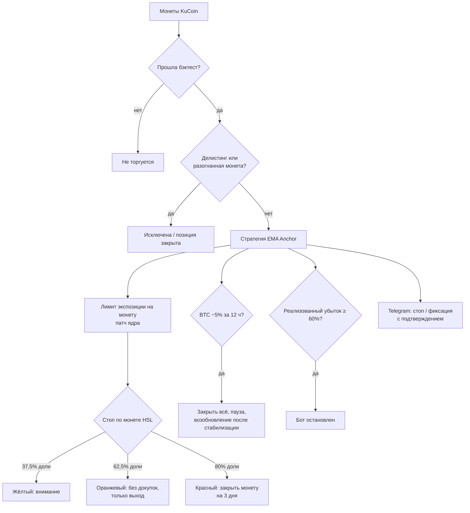

# TB Turbo 6.0 — торговый бот для KuCoin Futures, который подстраивается под стратегию, а не наоборот

[English](README.md) · **Русский**

> **Коротко.** TB — это готовая торговая система для фьючерсов KuCoin: ядро на
> Python + Rust, веб-панель, Telegram-бот, выкладка на сервер и симулятор.
> Стратегия в ней не зашита в код: она задаётся *пресетом* — базовым конфигом и
> списком переопределений. Сегодня по умолчанию работает **Turbo 6.0** —
> агрессивный скальп-профиль EMA Anchor (4 монеты × экспозиция 20, плечо 20).
> Его можно за минуту превратить в осторожный профиль с плечом 10 или в
> «обычного» долгосрочного бота — без единой строчки кода.
>
> ⚠️ Turbo 6.0 — профиль **высокого риска**. Прочитайте раздел
> [Риски](#риски--прочитайте-до-запуска) до того, как дадите боту деньги.

---

## Содержание

- [Что умеет бот](#что-умеет-бот)
- [Как работает стратегия EMA Anchor](#как-работает-стратегия-ema-anchor)
- [Turbo 6.0: параметры и результаты](#turbo-60-параметры-и-результаты)
- [Главное преимущество: одна система — любая стратегия](#главное-преимущество-одна-система--любая-стратегия)
- [Как мы подбираем настройки](#как-мы-подбираем-настройки)
- [Слои защиты](#слои-защиты)
- [Риски — прочитайте до запуска](#риски--прочитайте-до-запуска)
- [Варианты настройки](#варианты-настройки)
- [Быстрый старт](#быстрый-старт)
- [Состав репозитория](#состав-репозитория)

---

## Что умеет бот

- **Торгует фьючерсами KuCoin** (USDT-M, только лонг в текущих профилях) на
  отобранном списке монет — до 84 ликвидных контрактов, Turbo 6.0 работает на
  53 монетах, прошедших бэктест.
- **Веб-панель**: выбор пресета, баланс, экспозиция, число позиций, плечо,
  стопы, фильтры — всё ползунками и полями, с подсказками.
- **Режим «ставка»** (Turbo): бот торгует на выделенный баланс, панель следит
  за ставкой, умеет зафиксировать прибыль одной кнопкой, ставить на паузу при
  обвале BTC и возобновлять работу.
- **Telegram-бот**: отчёты, стоп и фиксация прибыли с 60-секундным
  подтверждением.
- **Сервер 24/7**: выкладка одной командой (Ubuntu + systemd), бот переживает
  перезапуск панели и сервера, ежечасные срезы и утренний отчёт.
- **Бумажная торговля и симулятор**: та же панель на исторических данных,
  13 сценариев-учений (ставки, обвалы BTC, делистинг, рестарты).

## Как работает стратегия EMA Anchor

EMA Anchor — стратегия «возврата к средней» с усреднением:

1. Бот строит коридор из двух скользящих средних цены (в Turbo 6.0 — EMA 160 и
   240 минут).
2. **Покупает ниже коридора** — на расстоянии `offset`, которое расширяется,
   когда рынок волатилен или позиция уже велика.
3. Если цена идёт дальше вниз — **докупает крупнее и ниже**
   (`entry_double_down_factor`), снижая среднюю цену входа.
4. **Продаёт выше коридора**, как только цена возвращается к средней.

Так бот зарабатывает на обычных колебаниях: большую часть времени он сидит в
кэше (средняя экспозиция по времени ≈ 0,2–0,3 баланса), а позиция живёт в
среднем около 10 часов. Корреляция дневного результата с BTC — всего ≈ 0,2:
бот зарабатывает и на падающем, и на растущем рынке, если он колеблется.

Слабое место такой стратегии — **обвал без отскока**: усреднение превращает
его в большой убыток. Поэтому половина этого проекта — не стратегия, а
[защита](#слои-защиты) вокруг неё.

## Turbo 6.0: параметры и результаты

| Параметр | Значение | Что значит |
|---|---|---|
| Стратегия | EMA Anchor, только лонг | покупка ниже EMA-коридора, продажа выше |
| EMA | 160 / 240 мин | быстрый скальп-коридор |
| `offset` | 0,014 | первая покупка на 1,4% ниже коридора |
| Позиций одновременно | 4 | |
| Экспозиция (TWEL) | 20 | суммарный объём позиций до 20× баланса |
| Плечо на бирже | 20 | |
| Кулдаун между входами | 1 мин | |
| Стоп по монете (HSL) | 0,375 / 0,625 / 0,80 доли | жёлтый → оранжевый (без докупок) → красный (закрыть монету на 3 дня) |
| Лимит реализованного убытка | 60% | бот останавливается сам |
| Выход при обвале BTC | −5% за 12 ч | закрыть всё, продолжить после стабилизации |
| Монеты | 53 | только прошедшие бэктест |

**Бэктест** (стартовый баланс 8,6 USDT, KuCoin, 53 монеты):

| Период | Результат | Макс. просадка |
|---|---:|---:|
| Февраль–апрель 2026 | **×4,29** | 33% |
| Май 2026 | ×1,54 | 14% |
| Июнь–октябрь 2026 | **×6,77** | 46% |
| 5–19 октября 2026 | ×1,31 | 19% |

Что важно понимать про эти цифры:

- **Это бэктест, а не обещание.** Параметры подбирались на данных 2026 года, и
  те же периоды показаны здесь — это оптимистичная оценка.
- **Просадки огромные.** Минус 33–46% на пути к иксам — нормальный режим
  работы профиля, а не авария.
- **Есть «обрыв».** При `offset` ≤ 0,010 тот же профиль теряет 80–95%.
  Значение 0,014 выбрано в середине устойчивого плато 0,013–0,016, а не на
  пике, — но это показывает, насколько профиль чувствителен к настройкам.

## Главное преимущество: одна система — любая стратегия

Большинство ботов — это одна стратегия, зашитая в код. TB устроен наоборот:

**1. Стратегия — это данные.** Пресет = базовый конфиг + переопределения.
Вот как выглядит (сокращённо) Turbo 6.0 в `panel/presets.json`:

```json
"turbo_ema5": {
  "mode": "bet",
  "risk": "high",
  "base": "tuned/ema_anchor.json",
  "bet_defaults": { "leverage": 20.0, "btc_exit": 0.05, "btc_exit_hours": 12, "hot_ratio": 3 },
  "overrides": {
    "bot.long.risk.total_wallet_exposure_limit": 20.0,
    "bot.long.risk.n_positions": 4.0,
    "bot.long.strategy.ema_anchor.offset": 0.014,
    "bot.long.strategy.ema_anchor.ema_span_0": 160.0,
    "bot.long.strategy.ema_anchor.ema_span_1": 240.0,
    "bot.long.hsl.red_threshold": 0.8,
    "live.max_realized_loss_pct": 0.6
  }
}
```

Новый профиль — это новый блок JSON. Панель сама соберёт из него конфиг,
покажет описание и уровень риска.

**2. Три стратегии в ядре.** TB Core (Rust) умеет `ema_anchor`,
`trailing_grid` и `trailing_martingale`; стратегия выбирается ключом конфига.

**3. Два режима работы — один код.** `bet` — турбо-ставка на выделенный баланс
с фиксацией прибыли; `main` — постоянная торговля с паузой при обвале BTC.
Режим задаётся профилем, а не отдельной программой.

**4. Ручки в панели.** Экспозиция, число позиций, плечо, порог стопа, выход по
BTC, фильтр разогнанных монет — меняются без правки файлов, панель сохраняет
настройки и переживает перезапуск.

**5. Свой патч ядра.** В Rust-ядро добавлено ограничение входа EMA Anchor по
экспозиции позиции (`cap_entry_qty_by_wel`): ни одна монета не вырастет больше
заданной доли, даже если стратегия хочет докупить.

## Как мы подбираем настройки

Каждый профиль проходит один и тот же путь — и большинство идей на нём
отсеиваются.

1. **Честный бэктест.** Список монет по месяцам того времени, *включая снятые
   с торгов*, реальные минимальные лоты KuCoin, комиссии биржи.
2. **Три уровня реализма исполнения.** «Бэктест», «реалистично» (проскальзывание
   0,2%, худшая цена за 5 минут при выходе) и «пессимистично» (0,5%, худшее
   за 10 минут, повышенные комиссии). Профиль, который живёт только в первом
   уровне, не принимается.
3. **Проверка на устойчивость.** Ключевые параметры сдвигаются на ±20%
   (`turbo/tb4/eval_neighbors.py`); если результат разваливается — параметр
   стоит на «обрыве», и его отодвигают в середину плато.
4. **Стресс-периоды.** Каждый профиль прогоняется через обвал 10.10.2025 — тот
   самый день, когда EMA Anchor без внешней защиты терял до 95%.
5. **Бумажная торговля и учения** на симуляторе панели перед выкладкой.

Что мы проверили и **отвергли** (подробности — в
[журнале решений](engine/docs/decisions_log.md)): фильтры по рыночному режиму,
фильтр пампов, шорты и хеджирование (все ликвидировались 10.10.2025 без выхода
по BTC), импульс по лидерам, сигналы разворота, сезонность, Donchian/RSI-
стратегии, выход по собственной просадке вместо BTC. Мы оставляем только то,
что работает **вне** периода подбора.

## Слои защиты



| Слой | Что делает | Зачем |
|---|---|---|
| Список проверенных монет | торгуются только 53 монеты из бэктеста | в живой торговле 04–19.10.2026 **весь** реализованный убыток дали 16 непроверенных монет |
| Защита от делистинга | закрывает позицию и исключает монету | делистинг = принудительное закрытие по плохой цене |
| Фильтр разогнанных монет | пропускает монеты, у которых цена за 30 дней менялась в 3+ раза (максимум / минимум) | после пампа часто идёт обвал без отскока |
| Лимит экспозиции на монету | патч Rust-ядра | одна монета не съедает весь баланс |
| Стоп по монете (HSL) | три уровня: жёлтый, оранжевый, красный | режет «падающий нож» до того, как он утянет весь счёт |
| Выход при обвале BTC | закрытие часа BTC на 5% ниже максимума за 12 ч → закрыть всё | без него бот терял 78–95% на обвале 10.10.2025, с ним — переживал |
| Лимит реализованного убытка | 60% → остановка | последний предохранитель |
| Защита от цикла падений | не более 3 перезапусков в час | бот не «долбит» биржу при сбое |
| Честные метрики | просадка считается от реального баланса счёта | ранние отчёты занижали просадку примерно в 20 раз — исправлено |

## Риски — прочитайте до запуска

- **Плечо 20 и экспозиция 20.** Позиции Turbo 6.0 в сумме могут в 20 раз
  превышать баланс. Резкое движение против позиций быстрее, чем сработают стопы,
  может стоить **всего депозита**.
- **Просадка — часть работы.** В бэктесте до −46% по часовым данным; внутри
  минуты бывает глубже (на прошлых профилях встречались минутные просадки
  до −48…−73%).
- **Бэктест оптимистичен.** Параметры подобраны на тех же данных. В реальном
  исполнении спокойные месяцы дают на 30–40% меньше, а месяц резкого обвала
  может закончиться почти полной потерей.
- **Чувствительность к настройкам.** `offset` ≤ 0,010 → потеря 80–95%. Не
  меняйте параметры стратегии наугад: используйте ручки панели или проверяйте
  изменения бэктестом.
- **Зависимость от защиты по BTC.** Без выхода по BTC обвал рынка, подобный
  10.10.2025, уничтожает счёт. Если данные BTC недоступны, правило
  пропускается — остаются только стопы по монетам и лимит убытка.
- **Маленький баланс.** Результаты выше получены на 8,6 USDT; на крупном
  балансе исполнение хуже (проскальзывание, глубина стакана), на очень
  маленьком — мешают минимальные лоты.
- **Фандинг не учтён** в бэктестах (исторически бот чаще получал фандинг, чем
  платил, но рассчитывать на это нельзя).
- **Риски биржи и инфраструктуры.** Сбой API, блокировка по региону, падение
  сервера, ошибка в коде. Бот — программа, а не страховка.

**Правила, которые мы советуем всем:** торгуйте на отдельном субаккаунте, только
теми деньгами, которые готовы потерять целиком; начните с бумажной торговли или
осторожного профиля; не выдавайте API-ключу права на вывод средств.

## Варианты настройки

| Профиль | Экспозиция × позиции | Плечо | Риск | Что показал бэктест |
|---|---|---:|---|---|
| **Turbo 6.0** (по умолчанию) | 20 × 4 | 20 | 🔴 высокий | ×4,29 / ×6,77 на отрезках 2026, просадка до 46% |
| **Осторожный турбо** (ручками в панели) | 4,5 × 5 | 10 | 🟡 средний | февраль–апрель 2026: ×1,11, просадка 17% (на тех же данных TWEL 24 давал просадку 72%) |
| **Обычный бот** (`ema_wide`, режим `main`) | 8 × 10 | 10 | 🟡 средний | 01.2024–09.2026: +152% (≈ +2,8% в месяц); худший месяц −49% (обвал 03.02.2025) |

Что крутить и как это влияет:

| Ручка в панели | Больше → | Меньше → |
|---|---|---|
| Экспозиция | выше доходность и просадка, ближе ликвидация | спокойнее, меньше прибыль |
| Позиций одновременно | риск размазан по монетам, на каждую меньше денег | концентрация: одна монета решает всё |
| Плечо на бирже | меньше маржи заморожено (риск задаётся экспозицией, но запас до ликвидации меньше) | больше запас маржи |
| Порог стопа по монете | реже срабатывает, глубже убыток по монете | чаще режет, больше ложных выходов |
| Выход при обвале BTC | **не отключайте** — это главная защита от обвалов рынка | |
| Фильтр разогнанных монет | строже отбор | больше монет в игре |

## Быстрый старт

1. Установите Python 3.12, Rust (stable) и Git.
2. Соберите ядро: [engine/docs/installation.md](engine/docs/installation.md),
   Rust-модуль — `engine/rustbuild.sh`.
3. Положите ключи биржи в `api-keys.json` (файл в `.gitignore` и в
   репозиторий не попадает). Ключу нужны права на торговлю, **без вывода**.
4. Запустите панель, выберите пресет, начните с бумажной торговли.
5. Для работы 24/7: замените `YOUR_SERVER_IP` в скриптах `deploy/` и
   `telegram/telegram_setup.bat` на адрес своего сервера и выполните
   `deploy/deploy.ps1`.

## Состав репозитория

| Папка | Что это |
|---|---|
| `engine/` | TB Core: Python + Rust (бэктест, оптимизация, живая торговля) |
| `turbo/` | бот: панель `tb4/panel/`, конфиги, списки монет, скрипты проверки устойчивости |
| `panel/` | общий исходник панели и пресеты |
| `telegram/` | Telegram-бот |
| `deploy/` | выкладка на сервер, отчёты, симулятор и учения `sim/` |
| `ai/` | карта проекта и правила для работы ИИ с кодом |
| `extras/` | исследования и архив |

## Реферальная ссылка

Регистрация на KuCoin по ссылке поддерживает проект:
**https://www.kucoin.com/r/rf/CXEENJJA**

## Отказ от ответственности

Материал не является инвестиционной рекомендацией. Торговля фьючерсами с плечом
связана с высоким риском потери всех вложенных средств. Результаты бэктестов не
гарантируют будущей доходности. Программа предоставляется «как есть», без
каких-либо гарантий; вы используете её на свой риск.

## Лицензия

Ядро TB Core — форк [passivbot](https://github.com/enarjord/passivbot),
распространяется как public domain (Unlicense); см. раздел License в
[engine/README.md](engine/README.md).
